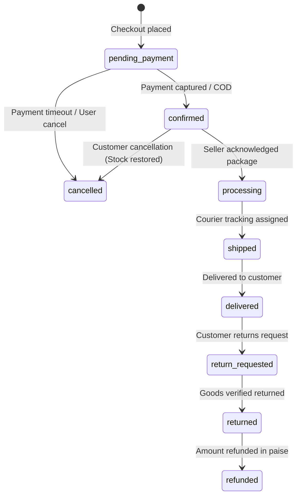

# ResCrafted 2.0 — Sustainable E-Commerce Marketplace

> *"Give Waste a Second Life."*

[]()
[]()
[]()
[]()
[]()

ResCrafted 2.0 is a full-stack, enterprise-grade sustainable e-commerce marketplace connecting eco-conscious consumers with verified artisans, upcyclers, and circular brands. Every listing features verified Life Cycle Assessment (LCA) environmental metrics, atomic inventory control, multi-seller fulfillment segregation, and integer-paise financial precision.

---

## Table of Contents
1. [Core Architectural Pillars](#1-core-architectural-pillars)
2. [System Architecture](#2-system-architecture)
3. [Technology Stack](#3-technology-stack)
4. [Life Cycle Assessment (LCA) Methodology](#4-life-cycle-assessment-lca-methodology)
5. [Role-Based Access Control (RBAC)](#5-role-based-access-control-rbac)
6. [Multi-Vendor Order & Fulfillment State Machine](#6-multi-vendor-order--fulfillment-state-machine)
7. [Directory Structure](#7-directory-structure)
8. [Getting Started & Local Development](#8-getting-started--local-development)
9. [API Reference Catalog](#9-api-reference-catalog)
10. [Automated Testing & Security Audit](#10-automated-testing--security-audit)
11. [Production Deployment & Runbook](#11-production-deployment--runbook)

---

## 1. Core Architectural Pillars

1. **Integer-Paise Financial Precision (`₹1.00 = 100 paise`)**:
   Floating-point arithmetic in JavaScript creates rounding inaccuracies (e.g., `0.1 + 0.2 !== 0.3`). ResCrafted stores and computes all monetary values—product pricing, subtotals, shipping thresholds, taxes, discount deductions, and Razorpay transactions—in whole integer paise.
2. **Server-Side Price & Stock Revalidation**:
   Client-submitted carts and amounts are never trusted. All calculations are executed strictly against authoritative MongoDB records upon checkout and payment verification.
3. **Atomic Stock Decrement with Compensating Rollback**:
   During checkout, inventory is atomically reserved using `findOneAndUpdate({ _id, stockQuantity: { $gte: qty }, status: 'published' }, { $inc: { stockQuantity: -qty } })`. If any single package item fails, previously reserved items are automatically rolled back. Stock is also restored if orders are cancelled.
4. **Verified Purchaser Reviews**:
   Customer reviews require verified purchase confirmation (`Order` must contain the item and not be cancelled). Duplicate reviews per purchase are blocked by a compound unique index `{ productId: 1, customerId: 1, orderId: 1 }`.
5. **Multi-Vendor Package Segregation**:
   A single customer order segregates items by artisan into independent `sellerFulfillments` packages. Each seller can independently acknowledge, assign courier tracking, and dispatch their package.
6. **Payment Security**:
   Dual-mode Razorpay gateway: deterministic offline sandbox adapter for zero-friction testing plus production HMAC SHA-256 signature verification (`crypto.createHmac`) and idempotent webhook deduplication.

---

## 2. System Architecture

```
+-----------------------------------------------------------------------------------+
|                                 CLIENT LAYER                                      |
|  React 18 + Vite | Tailwind CSS | TanStack Query | Recharts | Lucide Icons        |
|  (Lazy-loaded chunks: initial entry 34.88 kB, 97% reduction via code-splitting)   |
+-----------------------------------------+-----------------------------------------+
                                          | HTTPS / REST JSON (HttpOnly Cookies + Bearer)
                                          v
+-----------------------------------------------------------------------------------+
|                             BACKEND API GATEWAY                                   |
|  Node.js + Express 5 | Helmet Headers | CORS Allowlist | Rate Limiter | Pino      |
|  Recursive NoSQL MongoSanitizer | Centralized AppError Handler                    |
+-----------------------------------------+-----------------------------------------+
                                          |
        +---------------------------------+---------------------------------+
        v                                 v                                 v
+-----------------------+     +-----------------------+     +-----------------------+
|  Controllers (HTTP)   |     | Middlewares (RBAC)    |     |  Request Validation   |
|  Thin Request/Response|     | JWT Session / Roles   |     |  Zod Schemas          |
+-----------+-----------+     +-----------+-----------+     +-----------+-----------+
            |                             |                             |
            +-----------------------------+-----------------------------+
                                          v
+-----------------------------------------------------------------------------------+
|                                SERVICE LAYER                                      |
| Business Rules | Stock Atomicity | Paise Calculations | State Machines | Mappings |
+--------+------------------+-------------------+-------------------+---------------+
         |                  |                   |                   |
         v                  v                   v                   v
+----------------+  +----------------+  +----------------+  +-------------------+
| MongoDB Atlas  |  |   Cloudinary   |  |    Razorpay    |  | Transactional Mail|
| Mongoose 9     |  | Managed Media  |  | Payments &     |  | Nodemailer / Dev  |
| 11 Core Models |  | Storage / CDN  |  | HMAC Signature |  | Preview Stream    |
+----------------+  +----------------+  +----------------+  +-------------------+
```

---

## 3. Technology Stack

| Layer | Technologies |
|---|---|
| **Frontend** | React 18, Vite 6, Tailwind CSS, TanStack Query v5, Recharts, Lucide React, React Hook Form |
| **Backend** | Node.js 20+, Express 5, Mongoose 9, Zod, Pino Logger, Helmet, Express Rate Limit, Cookie Parser |
| **Database** | MongoDB Atlas (M0/Dedicated Cluster) with text and compound indexing |
| **Payments** | Razorpay Node SDK with deterministic mock sandbox fallback & webhook listener |
| **Media & Assets** | Cloudinary CDN with automatic fallback adapter |
| **Testing** | Node.js Test Runner (`node --test`), Supertest |

---

## 4. Life Cycle Assessment (LCA) Methodology

ResCrafted quantifies the ecological dividend of circular craftsmanship using documented Life Cycle Assessment (LCA) formulas:

- **Avoided Carbon Emissions ($kg\ CO_2$)**:
  $$\text{Avoided } CO_2 = \text{Product Weight (kg)} \times \left(\frac{\text{Recycled \%}}{100}\right) \times 4.6\text{ kg } CO_2\text{/kg}$$
  *Basis*: Virgin manufacturing produces $\sim 5.5\text{ kg } CO_2\text{/kg}$ vs. upcycled material processing at $\sim 0.9\text{ kg } CO_2\text{/kg}$ (84% carbon reduction).
- **Diverted Landfill Waste ($kg$)**:
  $$\text{Diverted Waste} = \text{Product Weight (kg)} \times \left(\frac{\text{Recycled \%}}{100}\right)$$
  Direct mass of reclaimed wood, textile, glass, or metal diverted from municipal landfills.
- **Circular Repairability Index ($1 - 10$)**:
  Scores modular disassembly, availability of replacement parts, and ease of restoration.
- **Zero-Waste Packaging**:
  100% plastic-free, water-activated paper tape, shredded cardboard cushioning, and biodegradable starch packaging.

---

## 5. Role-Based Access Control (RBAC)

| Capability / Route | Customer | Artisan / Seller | Administrator |
|---|:---:|:---:|:---:|
| Browse catalog, view LCA specs & reviews | Yes | Yes | Yes |
| Persistent Cart, Wishlist, Addresses | Yes | Yes | Yes |
| Place Order & Razorpay Checkout | Yes | Yes | Yes |
| Write Verified Customer Review | Yes (Purchased) | Yes (Purchased) | Yes (Purchased) |
| Manage Store Profile & Public Bio | No | Yes | Yes |
| Create / Update Own Product Listings | No | Yes | Yes |
| Fulfill Assigned Packages & Input Tracking | No | Yes | Yes |
| Access Seller Analytics (GMV, Low Stock) | No | Yes | Yes |
| Approve / Reject Seller Store Applications | No | No | Yes |
| Moderate Listings (Approve/Flag/Reject) | No | No | Yes |
| Suspend User Accounts & Audit Trails | No | No | Yes |
| Moderate Customer Reviews (Flag/Hide) | No | No | Yes |

---

## 6. Multi-Vendor Order & Fulfillment State Machine



---

## 7. Directory Structure

```
rescrafted/
├── backend/
│   ├── scripts/
│   │   └── smokeTest.js           # Production readiness & smoke test runner
│   ├── src/
│   │   ├── config/                # Database connection, env loader, Cloudinary
│   │   ├── controllers/           # HTTP handlers (Auth, Products, Cart, Orders, Dashboards, Reviews)
│   │   ├── middlewares/           # Authenticate, Authorize, RateLimiter, MongoSanitize, ErrorHandler
│   │   ├── models/                # 11 Mongoose Schemas (User, Product, Order, Review, Payment, etc.)
│   │   ├── routes/                # Express routes under /api/v1
│   │   ├── seed/                  # MongoDB Atlas catalog seed script
│   │   ├── services/              # Pure business logic, paise math, stock reservations
│   │   ├── utils/                 # AppError, Pino logger, API response helpers
│   │   ├── validators/            # Zod request validation schemas
│   │   ├── app.js                 # Express application assembly & security middleware
│   │   └── server.js              # Server entry point
│   └── tests/                     # 68 integration tests across 9 test suites
├── frontend/
│   ├── src/
│   │   ├── components/            # Reusable Atomic UI (Button, Modal, Badges, Layout)
│   │   ├── contexts/              # AuthContext, CartContext, WishlistContext, ToastContext
│   │   ├── pages/                 # Route views (Lazy-loaded chunks via React.lazy)
│   │   │   ├── admin/             # AdminDashboardPage.jsx
│   │   │   ├── seller/            # SellerDashboardPage.jsx
│   │   │   └── ...                # Catalog, ProductDetails, Checkout, Orders, Profile
│   │   ├── services/              # Axios API clients
│   │   └── App.jsx                # Routing & Suspense boundary
│   └── vite.config.js             # Vite config with function-based vendor chunking
├── package.json                   # Root monorepo scripts
└── README.md                      # Platform documentation
```

---

## 8. Getting Started & Local Development

### Prerequisites
- Node.js `20.x` or higher
- MongoDB Atlas cluster or local MongoDB instance
- Git

### 1. Clone & Install Dependencies
```powershell
# Clone the repository
git clone https://github.com/your-org/rescrafted.git
cd rescrafted

# Install backend dependencies
cd backend
npm install

# Install frontend dependencies
cd ../frontend
npm install --legacy-peer-deps
cd ..
```

### 2. Configure Environment Variables
Create `.env` inside `backend/`:
```env
PORT=5000
NODE_ENV=development
FRONTEND_URL=http://localhost:5173
MONGO_URI=mongodb+srv://<user>:<password>@cluster0.mongodb.net/rescrafted?retryWrites=true&w=majority
JWT_SECRET=super_secret_jwt_key_at_least_32_characters_long
COOKIE_SECRET=super_secret_cookie_signing_key_at_least_32_chars
CLOUDINARY_CLOUD_NAME=your_cloud_name
CLOUDINARY_API_KEY=your_api_key
CLOUDINARY_API_SECRET=your_api_secret
RAZORPAY_KEY_ID=rzp_test_your_key_id
RAZORPAY_KEY_SECRET=your_razorpay_secret
RAZORPAY_WEBHOOK_SECRET=your_webhook_secret
```

Create `.env` inside `frontend/`:
```env
VITE_API_BASE_URL=http://localhost:5000/api/v1
VITE_RAZORPAY_KEY_ID=rzp_test_your_key_id
```

### 3. Seed the Circular Product Catalog
```powershell
npm run seed --prefix backend
```

### 4. Run the Development Servers
In two separate terminals:
```powershell
# Terminal 1: Backend API Gateway (Port 5000)
npm run dev --prefix backend

# Terminal 2: Frontend Client (Port 5173)
npm run dev --prefix frontend
```

---

## 9. API Reference Catalog

All endpoints are versioned under `/api/v1`.

### Health & Probe
| Method | Endpoint | Description | Access |
|---|---|---|---|
| `GET` | `/` | Root discovery probe | Public |
| `GET` | `/api/v1/health` | System health check & database ping | Public |

### Authentication (`/api/v1/auth`)
| Method | Endpoint | Description | Access |
|---|---|---|---|
| `POST` | `/register` | Register customer or artisan | Public (Rate Limited) |
| `POST` | `/login` | Dual-mode login (HttpOnly cookie + Bearer) | Public (Rate Limited) |
| `POST` | `/logout` | Clear session cookies | Authenticated |
| `GET` | `/me` | Get current user profile | Authenticated |
| `POST` | `/verify-email` | Verify email with OTP | Public |
| `POST` | `/forgot-password` | Request password reset token | Public (Rate Limited) |
| `POST` | `/reset-password/:token` | Reset password using token | Public |
| `PATCH` | `/update-password` | Update current password | Authenticated |

### Catalog & Categories (`/api/v1/products`, `/api/v1/categories`)
| Method | Endpoint | Description | Access |
|---|---|---|---|
| `GET` | `/categories` | List all sustainable categories | Public |
| `POST` | `/categories` | Create category | Admin |
| `GET` | `/products` | Search, multi-facet filter, paginate listings | Public |
| `GET` | `/products/:slug` | Get listing details & related crafts | Public |
| `POST` | `/products` | Create product listing | Seller / Admin |
| `PATCH` | `/products/:id` | Update product listing | Seller (Owner) / Admin |
| `DELETE` | `/products/:id` | Archive listing | Seller (Owner) / Admin |

### Shopping (`/api/v1/cart`, `/api/v1/wishlist`, `/api/v1/addresses`)
| Method | Endpoint | Description | Access |
|---|---|---|---|
| `GET` | `/cart` | Get customer cart with integer-paise summary | Authenticated |
| `POST` | `/cart/items` | Add product to cart | Authenticated |
| `PATCH` | `/cart/items/:id`| Update item quantity | Authenticated |
| `DELETE` | `/cart/items/:id`| Remove item from cart | Authenticated |
| `DELETE` | `/cart` | Clear cart | Authenticated |
| `GET` | `/wishlist` | Get wishlist items | Authenticated |
| `POST` | `/wishlist/items`| Toggle item in wishlist | Authenticated |
| `GET` | `/addresses` | List customer shipping addresses | Authenticated |
| `POST` | `/addresses` | Create shipping address | Authenticated |

### Checkout & Payments (`/api/v1/orders`, `/api/v1/payments`)
| Method | Endpoint | Description | Access |
|---|---|---|---|
| `POST` | `/orders` | Atomic inventory reservation & order creation | Authenticated |
| `GET` | `/orders` | List customer orders | Authenticated |
| `GET` | `/orders/:id` | Get order details & fulfillment tracking | Authenticated |
| `POST` | `/orders/:id/cancel` | Cancel order & restore inventory | Authenticated (Owner) |
| `POST` | `/payments/initiate` | Create Razorpay order | Authenticated |
| `POST` | `/payments/verify` | Server-side HMAC SHA-256 signature verification | Authenticated |
| `POST` | `/payments/webhook` | Idempotent Razorpay webhook listener | Public (Signature Verified) |

### Dashboards & Moderation (`/api/v1/seller`, `/api/v1/admin`)
| Method | Endpoint | Description | Access |
|---|---|---|---|
| `GET` | `/seller/dashboard` | Artisan gross revenue, pending orders, inventory | Seller |
| `GET` | `/seller/orders` | Packages assigned to artisan | Seller |
| `PATCH` | `/orders/:orderId/fulfillments/:fulfillmentId` | Dispatch package with tracking number | Seller / Admin |
| `GET` | `/admin/metrics` | Platform GMV, diverted waste, user count | Admin |
| `GET` | `/admin/users` | Manage user directory | Admin |
| `PATCH` | `/admin/users/:id/status` | Suspend or activate account | Admin |
| `GET` | `/admin/sellers` | Review artisan store applications | Admin |
| `PATCH` | `/admin/sellers/:id/status` | Approve or reject artisan store | Admin |
| `PATCH` | `/admin/products/:id/moderate` | Approve, flag, or reject listing | Admin |
| `GET` | `/admin/audit-logs` | Query platform audit log trail | Admin |

### Reviews & LCA Assessment (`/api/v1/reviews`)
| Method | Endpoint | Description | Access |
|---|---|---|---|
| `GET` | `/reviews/product/:productId` | List reviews & 5-star distribution | Public |
| `GET` | `/reviews/product/:productId/impact` | Get LCA environmental assessment | Public |
| `GET` | `/reviews/product/:productId/eligibility` | Check if customer is verified purchaser | Authenticated |
| `POST` | `/reviews` | Submit verified customer review | Authenticated (Buyer) |
| `DELETE` | `/reviews/:id` | Delete review & recalibrate ratings | Author / Admin |
| `PATCH` | `/reviews/:id/moderate` | Admin moderation (flag/hide) | Admin |

---

## 10. Automated Testing & Security Audit

The comprehensive test suite covers all 10 completed phases:
- **68 Automated Integration Tests** across 10 modules.
- **100% Pass Rate**.

```powershell
# Run the complete test suite
npm test --prefix backend
```

### Run Production Smoke Test
```powershell
npm run smoke --prefix backend
```

---

## 11. Production Deployment & Runbook

For complete deployment step-by-step instructions, see [`DEPLOYMENT_RUNBOOK.md`](./DEPLOYMENT_RUNBOOK.md).

```powershell
# 1. Verify tests
npm test --prefix backend

# 2. Run post-deploy smoke test
npm run smoke --prefix backend

# 3. Build optimized frontend for production
npm run build --prefix frontend
```

---

## License
ResCrafted 2.0 is licensed under the [ISC License](LICENSE).
Copyright (c) 2026 ResCrafted Team. All rights reserved.
